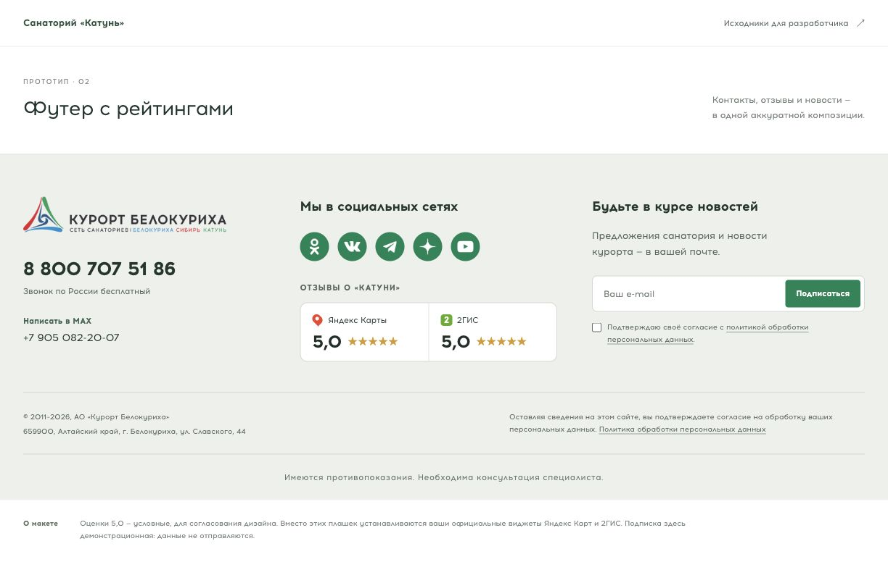
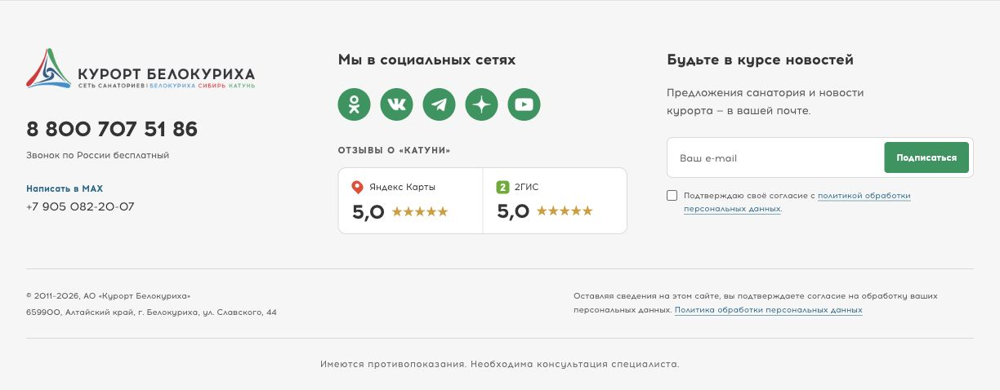

# Катунь — футер с рейтингами

[Вариант 1 — исходная мягкая палитра](https://kirschmunk.github.io/Kurort-Food/katun-footer/) · [Вариант 2 — цвета действующего сайта](https://kirschmunk.github.io/Kurort-Food/katun-footer/site-colors/)

Обновлённая композиция футера: слева логотип и контакты, в центре соцсети и парный блок рейтингов, справа подписка. На планшете подписка переходит на отдельную строку, на телефоне разделы располагаются последовательно. Оригинальный шрифт Acrom, логотип и социальные иконки сохранены. Фон сделан светлее, контакты и блоки выровнены по общей сетке.

## Два цветовых варианта

Первый вариант сохранён без изменений. Во втором изменена только палитра; расположение, размеры, отступы, шрифты, изображения и текст одинаковые. Ни в одном варианте нет демонстрационной шапки, вступления или нижнего пояснения.

Для **варианта 2** используйте [`site-colors/footer.html`](site-colors/footer.html), общие `footer.css` и `assets/`, затем подключите [`site-colors/colors.css`](site-colors/colors.css) после основного CSS. Дополнительный класс `kf2--site-colors` уже добавлен в разметку второго варианта. Пути к изображениям в этом фрагменте начинаются с `../assets/`; при переносе замените их на фактические пути сайта.

Цвета сверены на [действующем сайте Катуни](https://www.katun-san.ru/) 16.10.2026: зелёный кнопок и социальных значков `#00a067`, заголовки и контакты `#3b3b3b`, синие ссылки `#007296`. Тёмно-серый фон существующего сайта не используется: здесь почти белый нейтральный `#f7f7f7`. Цвета логотипа, значков карт и звёзд сохранены.

## Что брать разработчику

- [`footer.html`](footer.html) — HTML самого футера, без демонстрационных заголовков и пояснений.
- [`footer.css`](footer.css) — стили. Все селекторы изолированы префиксом `kf2`, шрифт имеет собственное имя. Файл можно подключить отдельно или добавить в общий CSS сайта.
- [`assets/`](assets/) — логотип, иконки и шрифты. Пути к изображениям в HTML и к шрифтам в CSS необходимо заменить на пути загрузки на сайте.
- [`index.html`](index.html) — целая демонстрационная страница, можно открыть в браузере. Ей также нужны CSS, `demo.js` и каталог `assets`.

## Подключение на сайт

1. Работать с шаблоном футера, а не с текстовым редактором страницы в CMS. Сохранить прежний вариант шаблона для возврата.
2. Заменить разметку видимой части футера содержимым `footer.html`. Не удалять системные подключения скриптов, счётчиков, чатов и других модулей, расположенные рядом с футером.
3. Подключить `footer.css` после общих стилей. `demo.css` (сброс отступов самостоятельной страницы) и `demo.js` на сайт не нужны. В демо оставлен только сам футер, без верхней панели, заголовка и блока «О макете».
4. Подставить официальные виджеты Катуни в два контейнера `.kf2__widget-slot` с атрибутами `data-provider="yandex"` и `data-provider="2gis"`. Заменяется содержимое контейнера, не сам контейнер. Ширину и высоту iframe оставить рекомендованными сервисом; в текущей композиции предусмотрены компактные виджеты около 150 × 50 px. Если предоставленные виджеты имеют другие размеры, адаптировать сетку под них и проверить мобильную версию.
5. Сохранить существующую серверную интеграцию подписки, проверку e-mail, обязательное согласие и обработчики ошибок/успеха. В демонстрации нет отправки данных: кнопка только показывает сообщение. Самостоятельно вставленный HTML не подключает подписку к Unisender.
6. Проверить действующие ссылки соцсетей, MAX, политику обработки данных и актуальность года копирайта; на сайте год лучше выводить из шаблона автоматически.

**Оценки 5,0 в прототипе условные. Это визуальные макеты, не официальные автоматически обновляемые виджеты. Не публиковать эти значения на основном сайте как реальные рейтинги.**

Основной сайт не изменён. Фиксированная рекламная полоса и сторонние чаты не воспроизведены: они остаются существующими независимыми модулями сайта.

## Проверка и пересборка демо

`node build.mjs` проверяет локальные ресурсы и собирает `index.html` из `demo-template.html` и `footer.html`. Для просмотра достаточно открыть `index.html` или запустить любой статический сервер из этого каталога.
