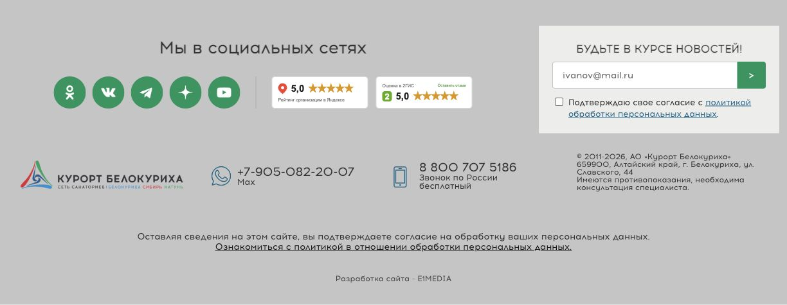
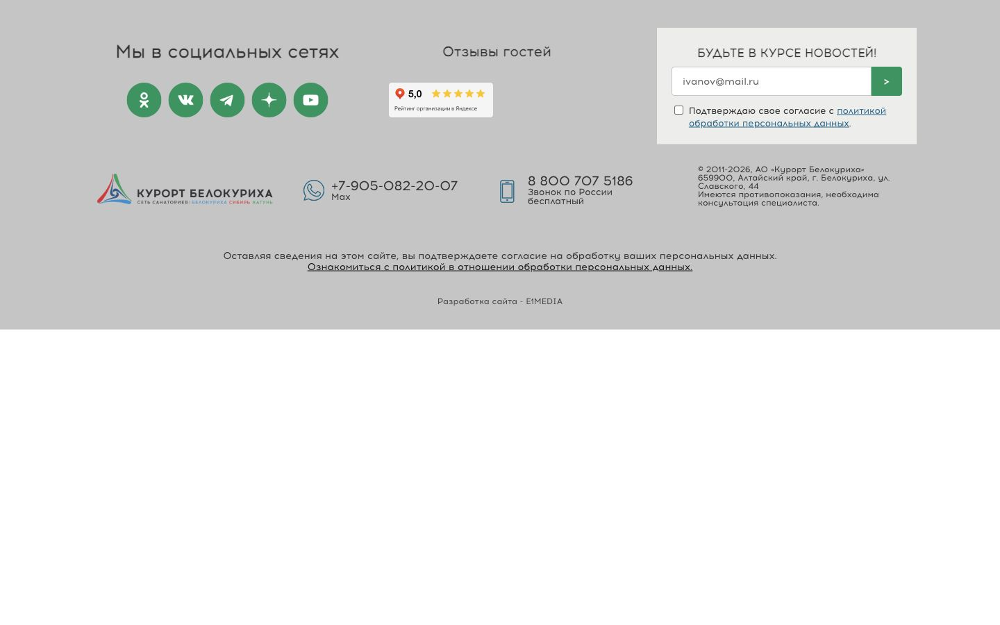
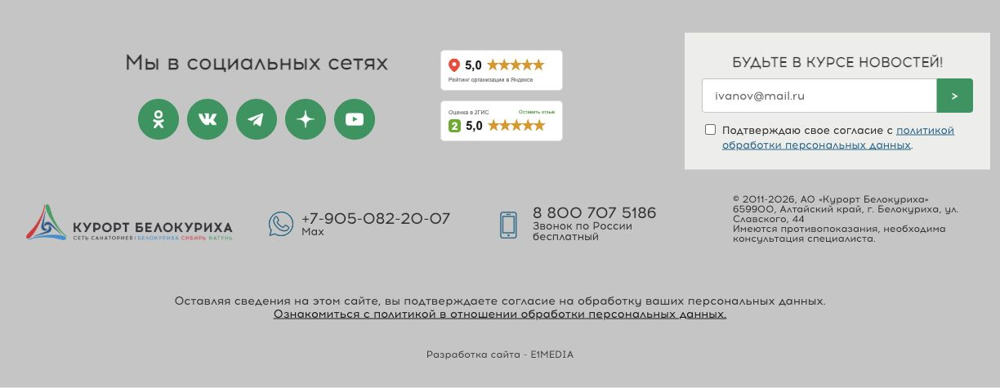

# Компактные соцсети и рейтинги — три варианта

Новый подход: уменьшить расстояния между социальными иконками и использовать освободившееся место для плашек. Остальные части футера не перерабатываются: фон, шрифты, зелёные иконки, подписка, логотип и контакты сохранены.

| Вариант | Демо | Исходники |
| --- | --- | --- |
| 1. Соцсети и рейтинги в одну линию | [Открыть](https://kirschmunk.github.io/Kurort-Food/katun-footer/current-footer/compact/inline/) | [Файлы](inline/) |
| 2. Две соседние группы с заголовками | [Открыть](https://kirschmunk.github.io/Kurort-Food/katun-footer/current-footer/compact/columns/) | [Файлы](columns/) |
| 3. Соцсети слева, плашки вертикально справа | [Открыть](https://kirschmunk.github.io/Kurort-Food/katun-footer/current-footer/compact/stacked/) | [Файлы](stacked/) |

В каждой папке: `social-block.html` для левой колонки, `compact.css` и инструкция по внедрению. Выбрать один вариант. Разметку остального футера не заменять. Плашки демонстрационные, оценки 5,0 условные; перед внедрением установить официальные виджеты Катуни.

**Для внедрения вариантов 1 и 2:** [готовые комплекты с точечной заменой, CSS и инструкцией](handoff/). Они сверены с публичной разметкой сайта 20.10.2026, сохраняют скрытые соцсети и учитывают Windows-1251. В установочных файлах нет условных оценок.

Пересборка: `node build.mjs` в этой папке. Проверяется неизменность разметки вне левой колонки, сохранение социальных ссылок, изоляция CSS, отсутствие повторяющихся ID и доступность локальных ресурсов.

Проверено 19.10.2026: все три варианта просмотрены в браузере. На ширинах 320, 390, 768, 1024 и 1224 px нет горизонтального переполнения или пересечений плашек с соцсетями, заголовком и подпиской; обе плашки остаются 150 × 50 px, изображения загружаются. Автоматические проверки кода пройдены. Это варианты для согласования; перед внедрением проверить выбранную компоновку с настоящими виджетами в шаблоне сайта.

## 1. В одну линию

## 2. Две соседние группы

## 3. Плашки вертикально справа

