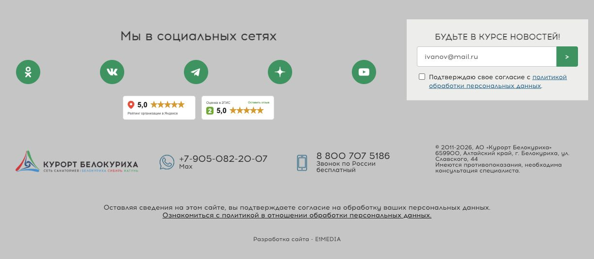

# Под соцсетями

[Демка](https://kirschmunk.github.io/Kurort-Food/katun-footer/current-footer/variants/social/)

## Точечная вставка

1. Подключить [ratings.css](ratings.css) после стилей сайта. В файл уже включены общие стили плашек и их расположение; другие CSS этой демонстрации на сайт не переносить.
2. Вставить [ratings.html](ratings.html) один раз. Место: Внутри `.page-footer__left`, сразу после закрывающего `div.page-footer__social-links`.
3. Оставить существующий футер, подписку, контакты, юридический текст, рекламную полосу и чаты без изменений. Не объединять несколько вариантов: выбрать один.
4. В двух слотах заменить демонстрационные плашки официальными виджетами Катуни, рассчитанными на 150 × 50 px. Если размеры виджетов отличаются, согласованно изменить размеры слотов.

Оценки 5,0 условные, не подтверждены как текущие. Макеты нельзя переносить на основной сайт вместо настоящих рейтингов. Демо не отправляет данные формы подписки.

Самостоятельная демка использует общие ресурсы из родительских папок. Для локального открытия скачать каталог katun-footer целиком. Основной сайт не изменён.
